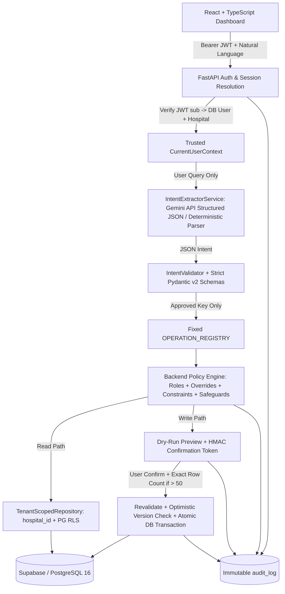

# System Architecture

## 1. High-Level Request & Execution Flow

## 2. Where Each Security & Safety Check Occurs

| Control Layer | File / Component | Responsibility |
|---|---|---|
| **Identity Resolution** | `backend/app/core/security.py`, `backend/app/api/dependencies.py` | Verifies Supabase or demo JWT signature & expiry; resolves `user_id`, `hospital_id`, `is_active`, and `roles` strictly from `users` / `user_roles` tables by `auth_user_id`. Ignores any `hospital_id` or `role` in JWT claims or chat prompts. |
| **Tenant Isolation** | `backend/app/repositories/base.py`, `backend/migrations/versions/002_rls_policies.py` | Every repository query filters by `model.hospital_id == self.hospital_id` and executes `SELECT set_config('app.current_hospital_id', ...)` so PostgreSQL RLS policies enforce fail-closed tenant boundaries. |
| **Intent & Schema Validation** | `backend/app/services/llm/intent_extractor.py`, `backend/app/services/intent/validator.py`, `backend/app/schemas/operations.py` | Extracts structured intent only, rejects SQL-like payloads, enforces `ConfigDict(extra="forbid")`, and triggers clarification when parameters are missing or ambiguous. |
| **Fixed Dispatch** | `backend/app/registry/operation_registry.py` | Maps only the 8 approved operation keys to predefined Python handlers. No dynamic imports or raw SQL execution. |
| **Permission & Constraint Engine** | `backend/app/services/permissions/engine.py` | Resolves `role_permissions` + `user_permission_overrides` (`DENY` > `ALLOW` > role grant), enforces `max_rows=500`, `max_discount_pct` (`10%` Billing Manager / `100%` Admin), `own_only` scope for Front Desk, and admin access-management safeguards. |
| **Dry-Run Preview & Confirmation** | `backend/app/services/preview/confirmation_service.py` | Generates before/after samples, `Asia/Kolkata` date ranges, `Decimal` financial impact, and stores SHA-256 hashed HMAC-signed confirmation tokens bound to `(user_id, hospital_id, operation, parameters, expected_row_count, snapshot_hash, expires_at)`. Enforces typing exact row count when `affected_rows > 50`. |
| **Atomic Execution & Stale Detection** | `backend/app/services/operations/*.py` | Revalidates permissions, checks `snapshot_hash` (`id` + `version`) inside an atomic transaction, increments `version`, commits all or rolls back on mismatch/error. |
| **Audit Logging** | `backend/app/services/audit/audit_service.py` | Append-only logging for every attempt (`SUCCESS`, `DENIED`, `CANCELLED`, `CLARIFICATION_REQUIRED`, `PREVIEW_CREATED`, `FAILED`, `NOT_EXECUTED`). Redacts sensitive keys and blocks `UPDATE`/`DELETE` via DB trigger + API design. |

## 3. Documented Business Assumptions

1. **Discount Replacement Policy**: Applying a percentage discount (`bills.discount`) replaces any prior `discount_amount` on `gross_amount` rather than compounding onto `net_amount`. Monetary values are computed using Python `Decimal` and rounded using `ROUND_HALF_UP` to 2 decimal places (`0.01`).
2. **Front Desk "Own Bills Only"**: Defined strictly via server-side `bills.created_by_user_id == current_user.user_id`, never by matching patient names.
3. **Time Zone & Half-Open Intervals**: Relative periods such as `"last month"` or `"next 30 days"` are resolved in `Asia/Kolkata` and converted to half-open UTC intervals `[start_utc, end_utc_exclusive)`.
4. **Hard 500-Row Cap**: `inventory.update` is capped at 500 rows per operation for all roles including `Admin`, preventing accidental hospital-wide overwrites.
5. **User Override Precedence**: `user_permission_overrides` with `effect = 'DENY'` overrides all role grants and `ALLOW` overrides. Modifying one user's override never alters shared `role_permissions`.
6. **Ambiguous User Name Resolution**: If multiple employees in the same hospital share a name, `users.manage_access` halts and asks for clarification by full name or email.

